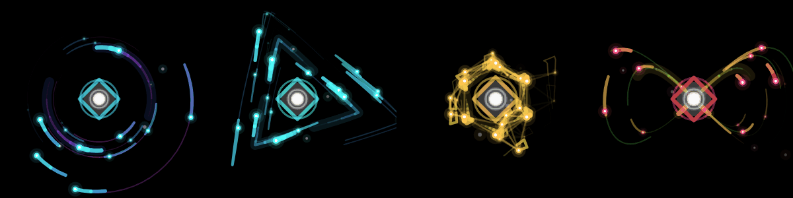
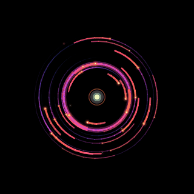
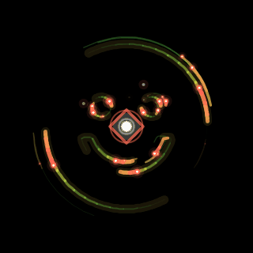
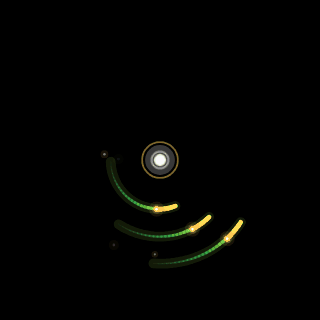
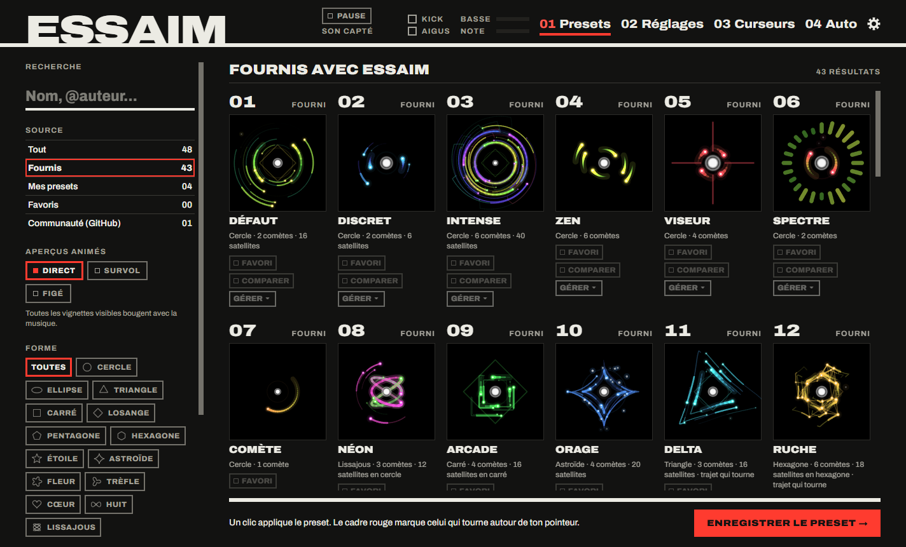
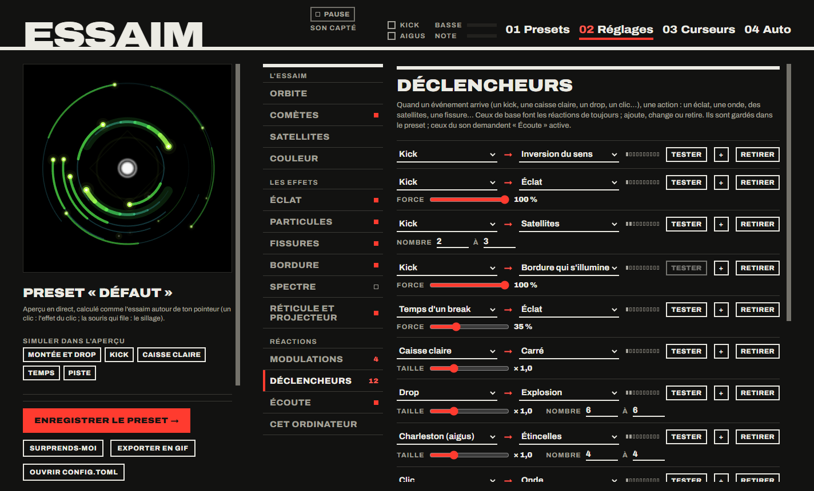
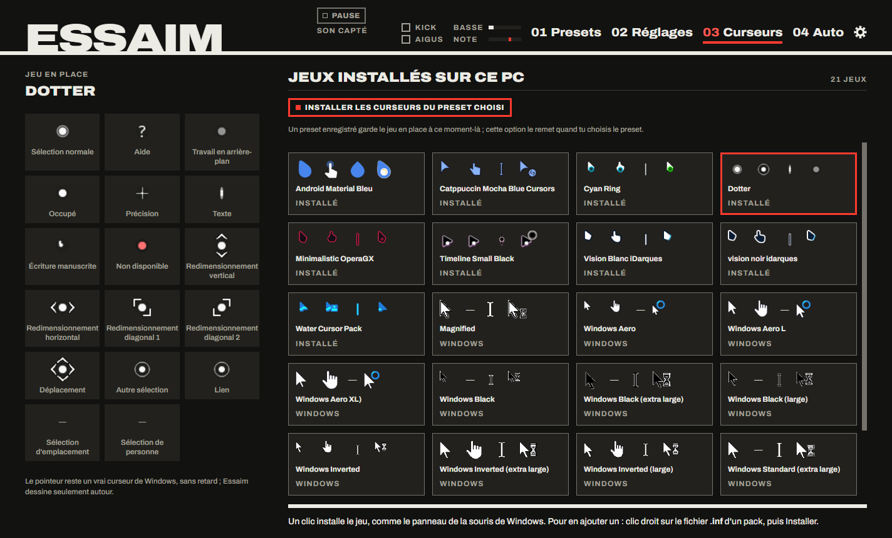

<div align="center">


# Essaim

**Comets and a swarm of satellites dancing around your mouse pointer, to the beat of the
music.**

An overlay for Windows that listens to what your PC plays (Spotify, browser, games…): every kick
reverses the rotation and releases satellites, the bass speeds up and widens the orbits, cymbals
throw sparks.

[](LICENSE)


[**Install**](#install) ·
[Features](#features) ·
[FAQ](#faq) ·
[Full guide (French)](docs/guide.md) ·
[Français](README.md)



</div>

*Essaim* is French for *swarm*. The app and its settings window are in French.

## Why Essaim?

- **It really listens.** Kicks are recognized by a small model trained on real tracks
  (electronic, dubstep, rap, rock…), about 25 ms after they hit: the swarm lands on the beat, not
  after it. Nothing to plug in: Essaim listens to what Windows plays.
- **Your pointer stays yours.** It is the real Windows cursor, with no lag; Essaim only draws
  around it, in a click-through layer.
- **Light.** Drawn by the GPU: 0.35 ms per frame on the benchmark, about 3% of one CPU core in
  use. It goes to sleep when a game or video goes fullscreen.
- **Your way.** 14 path shapes, or your own drawn by hand; presets animated live; every setting
  applied instantly, with its cost shown.

## Features

<table>
<tr>
<td width="33%" valign="top"></td>
<td width="33%" valign="top"></td>
<td width="33%" valign="top"></td>
</tr>
<tr>
<td valign="top"><b>It follows the music</b>: the kick reverses the rotation and adds satellites,
the bass speeds it up, a low note widens the orbits, the highs sparkle.</td>
<td valign="top"><b>Your own path</b>: draw a loop with the mouse and the comets travel it at
constant speed. Or pick one of 14 shapes, which can spin on themselves.</td>
<td valign="top"><b>It reacts to clicks</b>: shockwave, shards and cracks that close again. And
a dust trail when the mouse moves fast.</td>
</tr>
</table>

**The settings window.** A grid of presets, each animated live with your music: one click
applies it. Save your own, compare two side by side, filter by shape.



<table>
<tr>
<td width="50%" valign="top"></td>
<td width="50%" valign="top"></td>
</tr>
<tr>
<td valign="top"><b>Settings</b> applied live on a large preview. Next to each one, a 1–10
score tells its power cost; the power in use is measured live.</td>
<td valign="top"><b>Cursors</b>: your Windows cursor schemes, animated, applied in one click. A
preset can carry its own.</td>
</tr>
</table>

| | |
|---|---|
| 🥁 **Kick** | Reverses the rotation, adds satellites, flash under the pointer |
| 🔊 **Bass** | Speeds up the rotation; the lower the note, the wider the orbits |
| ✨ **Highs** | Hi-hats and cymbals throw sparks |
| 🎨 **Color** | Fixed or cycling hue, color of the foreground app, of the website open in the browser, or drifting with the music |
| 🪟 **Border** | The active window's border takes the swarm's color and lights up on every kick |
| 🖱️ **Clicks** | Shockwave, shards, cracks |
| 🎵 **Now playing** | Album-art colour, a burst on track change, title in the tray tooltip and settings |
| 🥁 **Tempo** | The kick tempo is tracked: the swarm keeps pulsing through breaks without a kick drum |
| 🔦 **Find the pointer** | Shake the mouse (or press <kbd>Ctrl</kbd>+<kbd>Alt</kbd>+<kbd>F</kbd>) to dim the screen around the pointer; optional crosshair and spectrum ring |
| 🌙 **Stays out of the way** | Pauses for full-screen apps, presentations, on battery or in front of chosen apps; lowers its frame rate when the PC struggles; can be hidden from screenshots and streams |
| 🌀 **[Horizon](https://github.com/KingsRequin/horizon)** | A Horizon widget pauses and tunes Essaim from the bar |

**Also:** automatic preset by foreground app or time of day, global hotkeys
(<kbd>Ctrl</kbd>+<kbd>Alt</kbd>+<kbd>→</kbd> next preset, <kbd>Ctrl</kbd>+<kbd>Alt</kbd>+<kbd>P</kbd>
pause), presets in the tray menu, GIF export of the preview, *Surprends-moi* (random settings),
light or dark theme like Windows, sleep while you're away, automatic updates (downloaded, verified, applied on restart).
The **Dotter** cursor scheme (a simple dot) is included.

## Install

**Easiest:** download `essaim.exe` from the
[latest release](https://github.com/KingsRequin/essaim/releases/latest) and run it. Nothing to
install, no administrator rights: the settings window opens on first launch.

- First put the file where it will stay (for example `%LOCALAPPDATA%\Programs\Essaim`), then
  tick *Démarrer Essaim avec Windows* in the advanced settings.
- Windows may show « Windows protected your PC »: the executable isn't signed. *More info* →
  *Run anyway*.
- The **Dotter** cursor sits next to it: `curseur-Dotter.zip` (see step 3 below).
- Essaim then updates itself: a notification tells you about the download, then offers to
  restart.

**From source:** Essaim builds with one command.

1. Install [Rust](https://rustup.rs) and [Git](https://git-scm.com).
2. In PowerShell:
   ```powershell
   git clone https://github.com/KingsRequin/essaim
   cd essaim
   powershell -ExecutionPolicy Bypass -File scripts\install.ps1
   ```
   Essaim is built, copied to `%LOCALAPPDATA%\Programs\Essaim`, starts with Windows and shows up
   in the Start menu (« Essaim » and « Essaim - réglages »). No administrator rights needed.
3. *(Recommended)* Install the **Dotter** cursor: right-click
   `curseurs\Dotter\_install.inf` → *Install*, then pick it in the *03 Curseurs* tab.

Then: Essaim's tray icon → *Réglages…*

Uninstall: `scripts\uninstall.ps1` (your settings are kept).

## FAQ

<details>
<summary><b>Does it slow down my PC or my games?</b></summary>

With the GPU, a frame costs 0.35 ms on the benchmark; in use, about 3% of one CPU core. When a
window goes fullscreen (game, video), everything stops; at rest (mouse still, no music), the
frame rate drops. The settings window shows the power in use, measured live.
</details>

<details>
<summary><b>Does Essaim replace my cursor?</b></summary>

No. The pointer stays a real Windows cursor (otherwise it would lag): Essaim only draws around
it. It changes the cursor scheme only when you ask (*Curseurs* tab, or a preset applied with the
option checked).
</details>

<details>
<summary><b>Does Essaim watch my keyboard or my browsing?</b></summary>

No. No keyboard or mouse hook: clicks are read once per frame, and hotkeys go through
`RegisterHotKey` (Windows notifies Essaim of those keys only). The website color comes from a
thin strip at the top of the page on screen; the window title is only used to notice a page
change. The address is not read, and nothing is logged or sent: Essaim only connects to GitHub,
for the preset library and updates.
</details>

<details>
<summary><b>The swarm doesn't react to sound.</b></summary>

Essaim listens to Windows' *default* audio output. If your music plays on another output, pick it
in *Réglages › Avancé › Son › Sortie son écoutée*. The header of the settings window shows what Essaim hears (kick, highs, bass, note).
</details>

<details>
<summary><b>What about Windows 10?</b></summary>

Essaim is developed and tested on Windows 11. The colored border needs it; the rest should work on
Windows 10 (with WebView2, installed with Edge), but hasn't been tried there.
</details>

<details>
<summary><b>Where are my settings?</b></summary>

In `%APPDATA%\Essaim`: `config.toml` (commented, editable by hand), your presets in `profils\`,
and the log `essaim.log`.
</details>

## Roadmap

- **Shared preset library** on GitHub: publish yours, install others'.
- **More dot cursors**, designed to go with the swarm.

## Made with Claude Code

Essaim was written entirely with [Claude Code](https://claude.com/claude-code), Anthropic's coding
agent. [KingsRequin](https://github.com/KingsRequin) designed it and supervised all the work:
every feature was decided, reviewed and tried for real on a four-monitor PC before being kept.

## Contributing

Bugs and ideas: [issues](https://github.com/KingsRequin/essaim/issues). Internals, building and
audio analysis (French): [docs/technique.md](docs/technique.md).

## License

[MIT](LICENSE). The Archivo font and the Dotter cursors come under their own licenses: see
[THIRD-PARTY-NOTICES.md](THIRD-PARTY-NOTICES.md).
