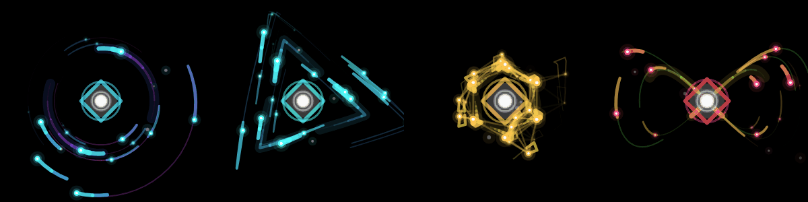
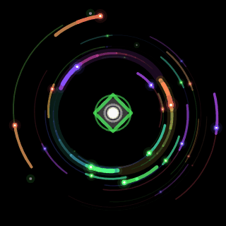
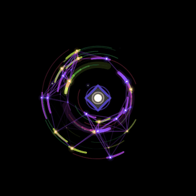
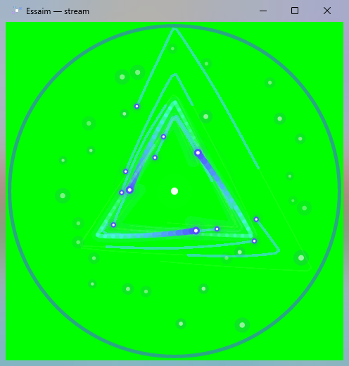
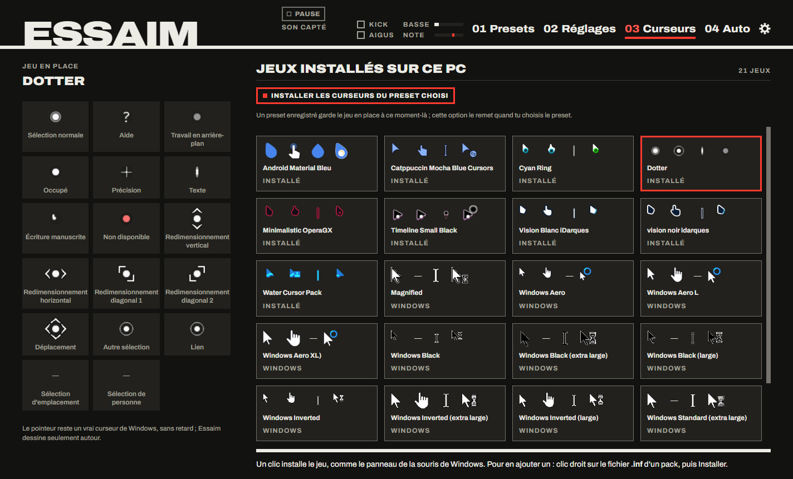

<div align="center">


# Essaim

**Des comètes et un essaim de satellites qui dansent autour de ton pointeur, au rythme de la
musique.**

Une surcouche pour Windows qui écoute le son du PC (Spotify, navigateur, jeux…) : chaque kick
inverse la rotation et lâche des satellites, la basse accélère et éloigne les orbites, les
cymbales font jaillir des étincelles, et au drop, tout explose.

[](LICENSE)


[**Installer**](#installation) ·
[Fonctions](#fonctions) ·
[Questions](#questions-fréquentes) ·
[Guide complet](docs/guide.md) ·
[English](README.en.md)



</div>

## Pourquoi Essaim ?

- **Il écoute vraiment la musique.** Le kick est reconnu par un petit modèle appris sur de vrais
  morceaux de 42 styles (de la techno au jazz, rap, rock, reggae, salsa…), en 25 ms environ et à
  n'importe quel volume : l'essaim tombe sur le temps, pas après. Il entend aussi la caisse claire, la montée avant un drop, le tempo et le côté qui joue.
  Rien à brancher : Essaim écoute ce que joue Windows.
- **Ton pointeur reste le tien.** C'est le vrai curseur de Windows, sans aucun retard ; Essaim
  dessine seulement autour, dans un calque transparent aux clics.
- **Léger.** Dessiné par la carte graphique : 0,31 ms de calcul par image au banc d'essai, environ
  3 % d'un cœur du processeur en usage. Il s'endort quand un jeu ou une vidéo passe en plein écran.
- **À ta façon.** 14 formes de trajet, les contours d'une image, d'un texte, d'un emoji ou de
  l'icône de l'appli au premier plan ; 51 presets fournis, animés en
  direct ; des déclencheurs (« au drop, une fissure », « sur la caisse claire, des étincelles ») et
  des modulations (« la rotation s'emballe au drop », « l'orbite s'ouvre sur les graves ») pour
  faire ton propre essaim ; des règles « si l'artiste est… alors tel preset » ; chaque réglage
  appliqué tout de suite, avec son coût affiché.

## Fonctions

<table>
<tr>
<td width="33%" valign="top"></td>
<td width="33%" valign="top"></td>
<td width="33%" valign="top"></td>
</tr>
<tr>
<td valign="top"><b>Il suit la musique</b> : le kick inverse la rotation et ajoute des
satellites, la basse accélère, une note grave éloigne les orbites, la caisse claire ouvre un
carré.</td>
<td valign="top"><b>Montée et drop</b> : pendant la montée, l'essaim se resserre et accélère ; au
drop, il explose en une grande onde et une gerbe d'étincelles.</td>
<td valign="top"><b>Il réagit aux clics</b> : onde de choc, éclats et fissures qui se referment ;
au clic droit, une onde qui se referme.</td>
</tr>
<tr>
<td valign="top"></td>
<td valign="top"></td>
<td valign="top"></td>
</tr>
<tr>
<td valign="top"><b>Le trajet d'une image</b> : un logo, un texte, un emoji (ou glisse une image
sur la fenêtre) ; chaque anneau de comètes suit un de ses contours. Ou 14 formes, qui peuvent
tourner sur elles-mêmes.</td>
<td valign="top"><b>Constellation et palette</b> : de fines lignes relient les satellites proches ;
comètes et satellites se partagent jusqu'à trois teintes.</td>
<td valign="top"><b>Fenêtre pour le stream</b> : l'essaim au centre, sur fond transparent pour
OBS (ou uni) ; elle suit ta musique comme l'essaim du pointeur.</td>
</tr>
</table>

### La musique

| | |
|---|---|
| 🥁 **Kick** | Inverse le sens de rotation, ajoute des satellites, éclat sous le pointeur, bordure qui s'illumine |
| 🔊 **Basse** | Accélère la rotation ; plus la note est grave, plus les orbites s'éloignent (deux modulations de base, à régler ou retirer) |
| ✨ **Aigus** | Charleston et cymbales font jaillir des étincelles |
| 🟦 **Caisse claire** | Un carré lumineux s'ouvre sous le pointeur sur chaque caisse claire ou clap |
| 🚀 **Montée et drop** | L'essaim se resserre et accélère pendant la montée, puis explose au drop |
| ⏱️ **Tempo** | L'essaim continue de pulser pendant les breaks sans grosse caisse ; en option, les têtes pulsent sur les contretemps |
| 🎧 **Stéréo** | En option, l'essaim penche vers le côté qui joue le plus fort |
| ⚡ **Déclencheurs** | Quand un événement arrive (kick, caisse claire, charleston, drop, temps, contretemps, break, changement de piste, clic, clic droit), une action : éclat, onde, éclats, étincelles, carré, fissure, implosion, satellites, explosion, rafale, inversion du sens, bordure qui s'illumine, rebond de l'orbite, poussée de la rotation, coup de frein ; avec un délai minimal et une chance (« un kick sur trois ») |
| 🎗️ **Rubans et ressorts** | Les comètes en rubans vrillés, sans tête blanche ; ou tout l'essaim sur ressorts : l'orbite rebondit au kick au lieu de changer de sens, les têtes s'étirent dans leur élan, les satellites naissent du centre |
| 🎛️ **Modulations** | Un élément du son (basse, note grave ou aiguë, kick, caisse claire, charleston, montée, drop, contretemps, tempo, brillance, stéréo) fait varier la rotation du trajet, la vitesse, l'accélération, le rayon, la taille, la teinte, le décalage, la lueur, la traînée ou l'opacité, des comètes, des satellites ou des deux ; avec un seuil, un lissage, et à l'envers si on veut |
| ◔ **Petites figures** | Des lignes fines qui laissent voir l'écran, seules ou avec l'essaim : deux arcs qui mesurent la basse et les aigus, quatre points qui comptent les temps sous le pointeur, un anneau qui suit le pointeur avec du retard et bat au kick, un orbe (le spectre en une ligne fermée), une ligne de voix, une trame de points traversée par des vagues, un trait de pinceau quand la souris file, un pendule qui saute au kick |
| 🎵 **Morceau en cours** | Couleur de la pochette, rafale au changement de piste, titre dans l'infobulle et les réglages |

### La souris et l'écran

| | |
|---|---|
| 🖱️ **Clics** | Onde de choc, éclats, fissures ; au clic droit, une onde qui se referme |
| 💨 **Mouvement** | Sillage de poussière quand la souris file ; en option, l'essaim traîne derrière elle comme sur un ressort |
| 🪟 **Fenêtre active** | Sa bordure prend la couleur de l'essaim et s'illumine sur chaque kick ; les étincelles rebondissent sur ses bords ; en option, quatre équerres à ses coins qui s'écartent au kick, et un liseré de lumière au bord bas de l'écran |
| 🎨 **Couleurs** | Teinte fixe ou qui défile, palette de deux ou trois teintes, couleur de l'appli au premier plan, du site ouvert, de la pochette, ou qui glisse avec la musique |
| 🔦 **Retrouver la souris** | Secouer la souris (ou <kbd>Ctrl</kbd>+<kbd>Alt</kbd>+<kbd>F</kbd>) assombrit l'écran autour du pointeur (sensibilité de la secousse, taille et assombrissement réglables) ; en option, réticule et anneau de spectre (qui s'efface quand la musique s'arrête) |

### Tout seul, et discret

| | |
|---|---|
| 🤖 **Si … alors …** | Des règles choisissent le preset : `artiste = Skrillex` → *Delta*, `bpm > 140 et heure >= 22:00` → *Intense*… ; ou selon l'appli au premier plan, ou l'heure |
| 🌙 **Discret quand il le faut** | Pause en plein écran, en présentation, sur batterie ou devant les applis choisies ; cadence allégée si le PC peine ; invisible des captures et des streams si on veut |
| 🫶 **Sans flashs** | Pour les personnes sensibles aux flashs : éclats adoucis, trois par seconde au plus, bordure qui ne clignote plus (tout seul si Windows réduit les animations) |
| 📺 **Fenêtre pour le stream** | L'essaim au centre d'une fenêtre à fond transparent, à ajouter dans OBS en *Capture de jeu* |
| 🌀 **[Horizon](https://github.com/KingsRequin/horizon)** | Un plugin d'Horizon met Essaim en pause, change de preset et ouvre ses réglages depuis la barre |

**Et aussi :** raccourcis globaux (<kbd>Ctrl</kbd>+<kbd>Alt</kbd>+<kbd>→</kbd> preset suivant,
<kbd>Ctrl</kbd>+<kbd>Alt</kbd>+<kbd>P</kbd> pause), presets dans le menu de l'icône, export de
l'aperçu en GIF, *Surprends-moi*, thème clair ou sombre comme Windows, veille quand on s'absente,
mises à jour automatiques (téléchargées, vérifiées, appliquées au redémarrage). Le jeu de curseurs
**Dotter** (un simple point) est fourni.

Toutes les fonctions en détail : [docs/guide.md](docs/guide.md).

## La fenêtre des réglages

À l'ouverture, le logo s'assemble en orbes, puis le nom file prendre sa place dans
l'en-tête pendant que la fenêtre se dessine (un clic l'abrège).

**Les presets.** Une grille de 51 presets fournis, tous différents, chacun avec ses propres réactions à la musique (zen, néon, orage, disco, fantôme, vortex, pochette, rubans, ressorts…), chacun animé
en direct avec ta musique : un clic l'applique. Enregistre les tiens, compare-en deux côte à côte,
filtre par forme. Publie-les dans la
[bibliothèque communautaire](https://github.com/KingsRequin/essaim-presets) et installe ceux des
autres.


<table>
<tr>
<td width="50%" valign="top"></td>
<td width="50%" valign="top"></td>
</tr>
<tr>
<td valign="top"><b>Réglages</b> rangés par familles (l'essaim, les effets, les réactions,
l'écoute), chacun avec ses options de base et avancées, appliqués en direct sur un grand aperçu
qui suit ta musique ; un bouton y simule une montée et un drop, un autre teste chaque
déclencheur. À côté de chaque réglage, dix cases disent ce qu'il coûte en puissance.</td>
<td valign="top"><b>Curseurs</b> : tes jeux de curseurs Windows, animés, mis en place d'un clic.
Un preset peut emporter le sien.</td>
</tr>
</table>

**Auto** : les règles qui choisissent le preset selon le morceau, le tempo, l'application ou
l'heure, et les raccourcis clavier.

**Application** (l'engrenage, à droite des onglets) : la version installée, la recherche d'une
mise à jour, le démarrage avec Windows, les pauses, les captures et le stream.

## Installation

**Le plus simple :** télécharge `essaim.exe` dans la
[dernière version](https://github.com/KingsRequin/essaim/releases/latest) et lance-le. Rien à
installer, pas de droits administrateur : la fenêtre des réglages s'ouvre au premier lancement.

- Range d'abord le fichier là où il restera (par exemple `%LOCALAPPDATA%\Programs\Essaim`),
  puis coche *Démarrer Essaim avec Windows* dans la vue *Application* (l'engrenage, en haut à droite).
- Windows peut afficher « Windows a protégé votre ordinateur » : l'exécutable n'est pas signé.
  *Informations complémentaires* → *Exécuter quand même*.
- Le curseur **Dotter** est à côté : `curseur-Dotter.zip` (voir l'étape 3 plus bas).
- Essaim se met ensuite à jour tout seul : une notification prévient du téléchargement, puis
  propose de redémarrer. Pour ne pas attendre : *Chercher une mise à jour* dans la vue *Application*.

**Depuis les sources :** Essaim se compile en une commande.

1. Installe [Rust](https://rustup.rs) et [Git](https://git-scm.com).
2. Dans PowerShell :
   ```powershell
   git clone https://github.com/KingsRequin/essaim
   cd essaim
   powershell -ExecutionPolicy Bypass -File scripts\install.ps1
   ```
   Essaim est compilé, copié dans `%LOCALAPPDATA%\Programs\Essaim`, démarre avec Windows et
   apparaît dans le menu Démarrer (« Essaim » et « Essaim - réglages »). Pas besoin de droits
   administrateur.
3. *(Conseillé)* Installe le curseur **Dotter** : clic droit sur
   `curseurs\Dotter\_install.inf` → *Installer*, puis choisis-le dans l'onglet *03 Curseurs*.

Ensuite : icône d'Essaim dans la zone de notification → *Réglages…*

Désinstaller : `scripts\uninstall.ps1` (tes réglages sont gardés).

## Questions fréquentes

<details>
<summary><b>Est-ce que ça ralentit mon PC ou mes jeux ?</b></summary>

Avec la carte graphique, une image coûte 0,31 ms de calcul au banc d'essai ; en usage, environ
3 % d'un cœur du processeur. Quand une fenêtre passe en plein écran (jeu, vidéo), tout s'arrête ; au repos (souris
immobile, pas de musique), la cadence baisse. La fenêtre des réglages affiche la puissance
utilisée, mesurée en direct.
</details>

<details>
<summary><b>Essaim remplace-t-il mon curseur ?</b></summary>

Non. Le pointeur reste un vrai curseur de Windows (il n'aurait pas de retard autrement) : Essaim
dessine seulement autour. Il ne change de jeu de curseurs que si tu le lui demandes (onglet
*Curseurs*, ou un preset appliqué avec l'option cochée).
</details>

<details>
<summary><b>Est-ce qu'Essaim surveille mon clavier ou ma navigation ?</b></summary>

Non. Pas de hook clavier ni souris : les clics sont lus à chaque image, et les raccourcis passent
par `RegisterHotKey` (Windows ne prévient Essaim que pour ces touches-là). La couleur du site
vient d'une petite bande du haut de la page à l'écran ; le titre de la fenêtre sert seulement à
voir qu'on a changé de page. L'adresse n'est pas lue, et rien n'est noté ni envoyé : Essaim ne
se connecte qu'à GitHub, pour la bibliothèque de presets et les mises à jour.
</details>

<details>
<summary><b>L'essaim ne réagit pas au son.</b></summary>

Essaim écoute la sortie audio *par défaut* de Windows. Si ta musique passe par une autre sortie,
choisis-la dans *Réglages › Écoute › Avancé › Sortie son écoutée*. L'en-tête de la fenêtre des réglages montre ce qu'Essaim entend (kick, aigus,
basse, note).
</details>

<details>
<summary><b>Les éclats me gênent (photosensibilité).</b></summary>

*Réglages › Cet ordinateur › Sans flashs* : *Toujours*. Les éclats du kick sont adoucis et limités à trois
par seconde, sans halo blanc, et la bordure de la fenêtre ne clignote plus. Par défaut (*Comme
Windows*), ce mode s'active tout seul quand les effets d'animation sont coupés dans Windows
(*Accessibilité › Effets visuels*).
</details>

<details>
<summary><b>Comment montrer l'essaim dans OBS ?</b></summary>

Icône d'Essaim → *Fenêtre pour le stream* (ou `essaim.exe --stream`). L'essaim y danse au centre,
à une taille qui tient toujours dans la fenêtre. Dans OBS : *Capture de jeu* en mode *Capturer une
fenêtre spécifique* sur « Essaim — stream », avec *Autoriser la transparence* et *Valeurs alpha
prémultipliées* cochées : le fond est transparent, lueurs comprises. Sinon, un fond uni (au choix
dans la vue *Application*) à retirer par *Incrustation chromatique* d'une *Capture de
fenêtre*. Elle reste capturable même si l'essaim autour du pointeur est masqué des captures.
</details>

<details>
<summary><b>Comment changer de preset selon l'artiste ou le tempo ?</b></summary>

Onglet *04 Auto*, partie *Si … alors …* : écris une condition (`artiste = Skrillex`,
`titre ~ remix`, `bpm > 140`, `appli = obs64.exe`, `heure >= 22:00`, ou plusieurs jointes par
« et ») et choisis le preset. Le bouton *Artiste en cours* remplit la condition pour le morceau
qui joue. Coche *Choisir le preset automatiquement* : quand plus aucune règle ne s'applique, tes
réglages d'avant reviennent.
</details>

<details>
<summary><b>Et Windows 10 ?</b></summary>

Essaim est développé et testé sous Windows 11. La bordure colorée en a besoin ; le reste devrait
marcher sous Windows 10 (avec WebView2, installé avec Edge), mais n'y a pas été essayé.
</details>

<details>
<summary><b>Où sont mes réglages ?</b></summary>

Dans `%APPDATA%\Essaim` : `config.toml` (commenté, modifiable à la main), tes presets dans
`profils\`, et le journal `essaim.log`.
</details>

## Feuille de route

- **D'autres curseurs en point**, pensés pour aller avec l'essaim.

## Fait avec Claude Code

Essaim a été entièrement écrit avec [Claude Code](https://claude.com/claude-code), l'agent de
programmation d'Anthropic. [KingsRequin](https://github.com/KingsRequin) l'a conçu et a supervisé
tout le travail : chaque fonction a été décidée, relue et essayée en vrai sur un PC à quatre
écrans avant d'être gardée.

## Contribuer

Bugs, idées et questions : un [formulaire à remplir](https://github.com/KingsRequin/essaim/issues/new/choose)
(ta version est écrite à côté du titre de la fenêtre des réglages). Fonctionnement interne, compilation et analyse du son : [docs/technique.md](docs/technique.md).

## Licence

[MIT](LICENSE). Police Archivo et curseurs Dotter fournis sous leur propre licence : voir
[THIRD-PARTY-NOTICES.md](THIRD-PARTY-NOTICES.md).
