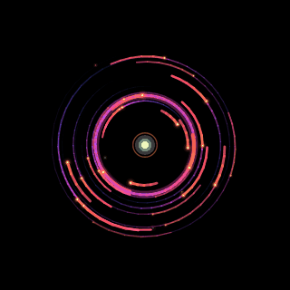
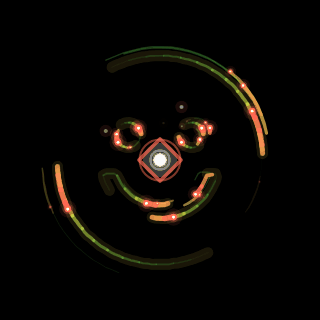
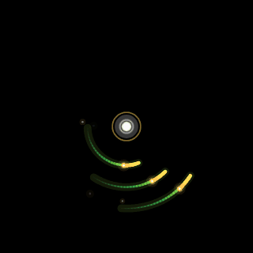
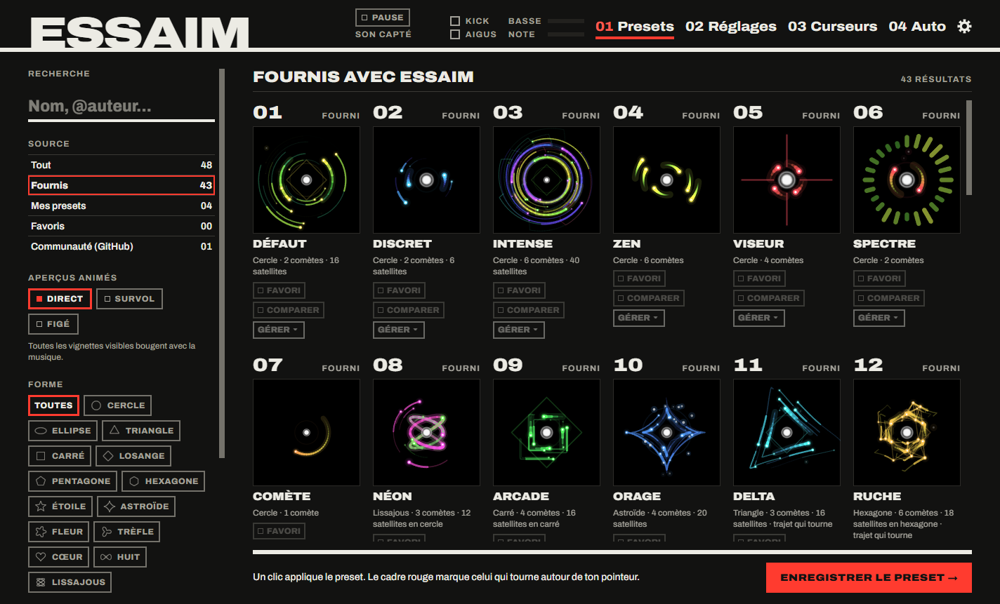
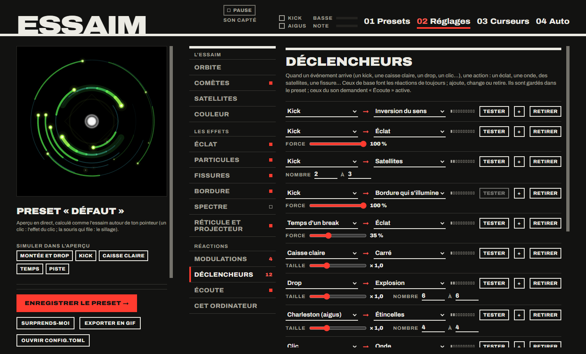

<div align="center">


# Essaim

**Des comètes et un essaim de satellites qui dansent autour de ton pointeur, au rythme de la
musique.**

Une surcouche pour Windows qui écoute le son du PC (Spotify, navigateur, jeux…) : chaque kick
inverse la rotation et lâche des satellites, la basse accélère et éloigne les orbites, les
cymbales font jaillir des étincelles.

[](LICENSE)


[**Installer**](#installation) ·
[Fonctions](#fonctions) ·
[Questions](#questions-fréquentes) ·
[Guide complet](docs/guide.md) ·
[English](README.en.md)


</div>

## Pourquoi Essaim ?

- **Il écoute vraiment la musique.** Le kick est reconnu par un petit modèle appris sur de vrais
  morceaux (électro, dubstep, rap, rock…), en 25 ms environ : l'essaim tombe sur le temps, pas
  après. Rien à brancher : Essaim écoute ce que joue Windows.
- **Ton pointeur reste le tien.** C'est le vrai curseur de Windows, sans aucun retard ; Essaim
  dessine seulement autour, dans un calque transparent aux clics.
- **Léger.** Dessiné par la carte graphique : 0,35 ms de calcul par image au banc d'essai, environ
  3 % d'un cœur du processeur en usage. Il s'endort quand un jeu ou une vidéo passe en plein écran.
- **À ta façon.** 14 formes de trajet ou le tien, dessiné à la main ; des presets animés en
  direct ; chaque réglage appliqué tout de suite, avec son coût affiché.

## Fonctions

<table>
<tr>
<td width="33%" valign="top"></td>
<td width="33%" valign="top"></td>
<td width="33%" valign="top"></td>
</tr>
<tr>
<td valign="top"><b>Il suit la musique</b> : le kick inverse la rotation et ajoute des
satellites, la basse accélère, une note grave éloigne les orbites, les aigus scintillent.</td>
<td valign="top"><b>Ton propre trajet</b> : trace une boucle à la souris, les comètes la
parcourent à vitesse constante. Ou choisis parmi 14 formes, qui peuvent tourner sur elles-mêmes.</td>
<td valign="top"><b>Il réagit aux clics</b> : onde de choc, éclats et fissures qui se
referment. Et un sillage de poussière quand la souris file.</td>
</tr>
</table>

**La fenêtre des réglages.** Une grille de presets, chacun animé en direct avec ta musique : un
clic l'applique. Enregistre les tiens, compare-en deux côte à côte, filtre par forme.



<table>
<tr>
<td width="50%" valign="top"></td>
<td width="50%" valign="top"></td>
</tr>
<tr>
<td valign="top"><b>Réglages</b> appliqués en direct sur un grand aperçu. À côté de chacun, une
note de 1 à 10 dit ce qu'il coûte en puissance ; la puissance utilisée est mesurée en direct.</td>
<td valign="top"><b>Curseurs</b> : tes jeux de curseurs Windows, animés, mis en place d'un clic.
Un preset peut emporter le sien.</td>
</tr>
</table>

| | |
|---|---|
| 🥁 **Kick** | Inverse le sens de rotation, ajoute des satellites, éclat sous le pointeur |
| 🔊 **Basse** | Accélère la rotation ; plus la note est grave, plus les orbites s'éloignent |
| ✨ **Aigus** | Charleston et cymbales font jaillir des étincelles |
| 🎨 **Couleur** | Teinte fixe ou qui défile, couleur de l'appli au premier plan, du site ouvert dans le navigateur, ou qui glisse avec la musique |
| 🪟 **Bordure** | La bordure de la fenêtre active prend la couleur de l'essaim et s'illumine sur chaque kick |
| 🖱️ **Clics** | Onde de choc, éclats, fissures |
| 🌀 **[Horizon](https://github.com/KingsRequin/horizon)** | Un widget d'Horizon met Essaim en pause et le règle depuis la barre |

**Et aussi :** preset automatique selon l'appli au premier plan ou l'heure, raccourcis globaux
(<kbd>Ctrl</kbd>+<kbd>Alt</kbd>+<kbd>→</kbd> preset suivant, <kbd>Ctrl</kbd>+<kbd>Alt</kbd>+<kbd>P</kbd>
pause), presets dans le menu de l'icône, export de l'aperçu en GIF, *Surprends-moi*, thème clair
ou sombre comme Windows, veille quand on s'absente, mises à jour automatiques (téléchargées, vérifiées, appliquées au
redémarrage). Le jeu de curseurs **Dotter** (un simple point) est fourni.

Toutes les fonctions en détail : [docs/guide.md](docs/guide.md).

## Installation

**Le plus simple :** télécharge `essaim.exe` dans la
[dernière version](https://github.com/KingsRequin/essaim/releases/latest) et lance-le. Rien à
installer, pas de droits administrateur : la fenêtre des réglages s'ouvre au premier lancement.

- Range d'abord le fichier là où il restera (par exemple `%LOCALAPPDATA%\Programs\Essaim`),
  puis coche *Démarrer Essaim avec Windows* dans les réglages avancés.
- Windows peut afficher « Windows a protégé votre ordinateur » : l'exécutable n'est pas signé.
  *Informations complémentaires* → *Exécuter quand même*.
- Le curseur **Dotter** est à côté : `curseur-Dotter.zip` (voir l'étape 3 plus bas).
- Essaim se met ensuite à jour tout seul : une notification prévient du téléchargement, puis
  propose de redémarrer.

**Depuis les sources :** Essaim se compile en une commande.

1. Installe [Rust](https://rustup.rs) et [Git](https://git-scm.com).
2. Dans PowerShell :
   ```powershell
   git clone https://github.com/KingsRequin/essaim
   cd essaim
   powershell -ExecutionPolicy Bypass -File scripts\install.ps1
   ```
   Essaim est compilé, copié dans `%LOCALAPPDATA%\Programs\Essaim`, démarre avec Windows et
   apparaît dans le menu Démarrer (« Essaim » et « Essaim - réglages »). Pas besoin de droits
   administrateur.
3. *(Conseillé)* Installe le curseur **Dotter** : clic droit sur
   `curseurs\Dotter\_install.inf` → *Installer*, puis choisis-le dans l'onglet *03 Curseurs*.

Ensuite : icône d'Essaim dans la zone de notification → *Réglages…*

Désinstaller : `scripts\uninstall.ps1` (tes réglages sont gardés).

## Questions fréquentes

<details>
<summary><b>Est-ce que ça ralentit mon PC ou mes jeux ?</b></summary>

Avec la carte graphique, une image coûte 0,35 ms de calcul au banc d'essai ; en usage, environ
3 % d'un cœur du processeur. Quand une fenêtre passe en plein écran (jeu, vidéo), tout s'arrête ; au repos (souris
immobile, pas de musique), la cadence baisse. La fenêtre des réglages affiche la puissance
utilisée, mesurée en direct.
</details>

<details>
<summary><b>Essaim remplace-t-il mon curseur ?</b></summary>

Non. Le pointeur reste un vrai curseur de Windows (il n'aurait pas de retard autrement) : Essaim
dessine seulement autour. Il ne change de jeu de curseurs que si tu le lui demandes (onglet
*Curseurs*, ou un preset appliqué avec l'option cochée).
</details>

<details>
<summary><b>Est-ce qu'Essaim surveille mon clavier ou ma navigation ?</b></summary>

Non. Pas de hook clavier ni souris : les clics sont lus à chaque image, et les raccourcis passent
par `RegisterHotKey` (Windows ne prévient Essaim que pour ces touches-là). La couleur du site
vient d'une petite bande du haut de la page à l'écran ; le titre de la fenêtre sert seulement à
voir qu'on a changé de page. L'adresse n'est pas lue, et rien n'est noté ni envoyé : Essaim ne
se connecte qu'à GitHub, pour la bibliothèque de presets et les mises à jour.
</details>

<details>
<summary><b>L'essaim ne réagit pas au son.</b></summary>

Essaim écoute la sortie audio *par défaut* de Windows. Si ta musique passe par une autre sortie,
mets-la par défaut. L'en-tête de la fenêtre des réglages montre ce qu'Essaim entend (kick, aigus,
basse, note).
</details>

<details>
<summary><b>Et Windows 10 ?</b></summary>

Essaim est développé et testé sous Windows 11. La bordure colorée en a besoin ; le reste devrait
marcher sous Windows 10 (avec WebView2, installé avec Edge), mais n'y a pas été essayé.
</details>

<details>
<summary><b>Où sont mes réglages ?</b></summary>

Dans `%APPDATA%\Essaim` : `config.toml` (commenté, modifiable à la main), tes presets dans
`profils\`, et le journal `essaim.log`.
</details>

## Feuille de route

- **Bibliothèque de presets partagés** sur GitHub : publier les tiens, installer ceux des autres.
- **D'autres curseurs en point**, pensés pour aller avec l'essaim.

## Fait avec Claude Code

Essaim a été entièrement écrit avec [Claude Code](https://claude.com/claude-code), l'agent de
programmation d'Anthropic. [KingsRequin](https://github.com/KingsRequin) l'a conçu et a supervisé
tout le travail : chaque fonction a été décidée, relue et essayée en vrai sur un PC à quatre
écrans avant d'être gardée.

## Contribuer

Bugs et idées : [issues](https://github.com/KingsRequin/essaim/issues). Fonctionnement interne,
compilation et analyse du son : [docs/technique.md](docs/technique.md).

## Licence

[MIT](LICENSE). Police Archivo et curseurs Dotter fournis sous leur propre licence : voir
[THIRD-PARTY-NOTICES.md](THIRD-PARTY-NOTICES.md).
